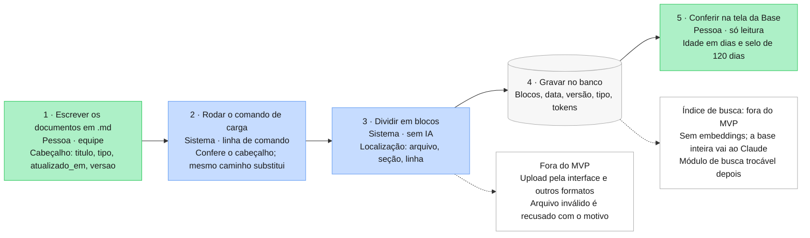
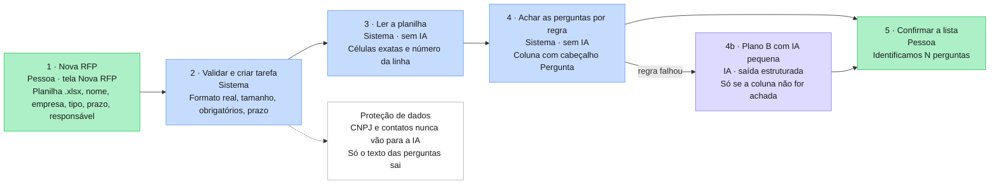
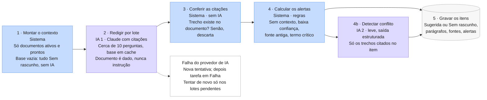
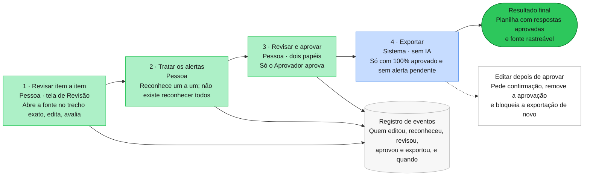
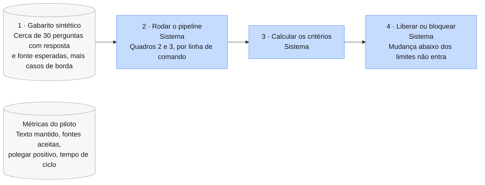

# Pipeline de IA do MVP · Tendra.ai

*Proposta de 21/10/2026. Status: `draft`. Complementa a seção 20 do `PRD_Front-end_Tendra.ai_MVP_v3.md`, `docs/mvp-resposta-rfp/` e `docs/mvp-proposta-1/`.*

Versão editável do diagrama, no board do projeto: [Miro](https://miro.com/app/board/uXjVHg0R4nQ=/?moveToWidget=3458764688008238401).

O pipeline cobre a jornada completa: da base de conhecimento e da planilha de RFP até a planilha de respostas aprovadas por pessoas.

## Decisões que definem o desenho

- **Fluxo fixo em código, sem agente.** O backend executa as etapas em ordem e chama o Claude só onde há linguagem natural a tratar.
- **Entrada da RFP: somente `.xlsx`.**
- **Base de conhecimento: arquivos `.md` carregados pela equipe, por comando**, direto no banco. Sem upload pela interface no MVP.
- **Sem busca vetorial.** A base inteira vai ao Claude, que encontra e cita os trechos. A recuperação fica atrás de um módulo próprio (`buscarFontes`), trocável depois.
- **A IA sugere, a pessoa decide.** Nada é aprovado nem exportado pela IA.
- **Limites de qualidade:** relevância 80% e fidelidade 90%.

## Legenda

| Cor | Significado |
|---|---|
| Verde | Pessoa decide ou age |
| Azul | Sistema: regras em código, sem IA |
| Roxo | IA (Claude via API) |
| Cinza | Dados guardados |
| Linha tracejada | Exceção ou falha |

## 1. Preparar a base de conhecimento

Acontece antes das RFPs e a cada novo documento. Nenhuma chamada de IA. O formato do cabeçalho está em [`FORMATO_BASE_MD.md`](FORMATO_BASE_MD.md).

## 2. Entender a RFP

Do arquivo enviado à lista de perguntas confirmada. A IA só entra se a regra falhar.

## 3. Gerar respostas com fonte

O núcleo do produto. No máximo duas chamadas de IA por lote.

## 4. Revisar, aprovar e exportar

A pessoa decide. Nenhum item é aprovado ou exportado pela IA.

## 5. Medir e proteger a qualidade

Roda fora do caminho do usuário. Decide se uma mudança de prompt, modelo ou parâmetro pode entrar.

As métricas do piloto vêm do registro de eventos do quadro 4 e não dependem do comando de avaliação.

### Critérios e limites

| Critério | Limite |
|---|---|
| Validade das fontes (citação confere literalmente com o documento) | 100% |
| Texto apresentado sempre com ao menos uma fonte válida | 100% |
| Relevância da recuperação | **80%** |
| Pergunta sem resposta no gabarito fica sem rascunho | 100% |
| Conflito embutido na base marcado com o alerta de conflito | 100% |
| Citações de documentos fora da base autorizada | Nenhuma |
| Instrução maliciosa e pedido de compromisso não sustentado tratados corretamente | 3 de 3 execuções |
| Fidelidade do conteúdo | **90%** |

## Decisões em aberto

- Método de medir a fidelidade: revisão humana de uma amostra ou avaliador automático com modelo. Proposta: começar pela revisão humana da amostra do gabarito.
- Modelo da redação (Sonnet 5.5 ou Opus 5.5) e tamanho do lote: decididos pela avaliação contra o gabarito.
- Interface do comando de carga (nome e opções). O formato dos arquivos `.md` está definido em [`FORMATO_BASE_MD.md`](FORMATO_BASE_MD.md).
- A segunda chamada de IA (conflito) existe porque a API não combina citações com saída estruturada na mesma chamada; o teste prático da primeira etapa pode eliminá-la.
